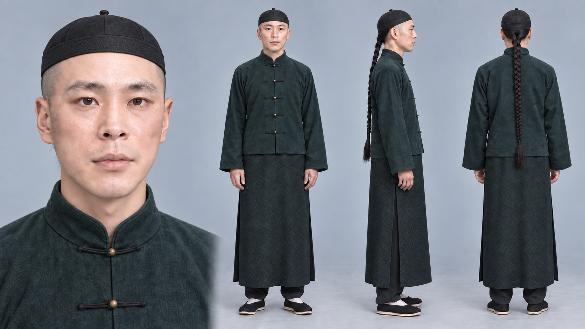
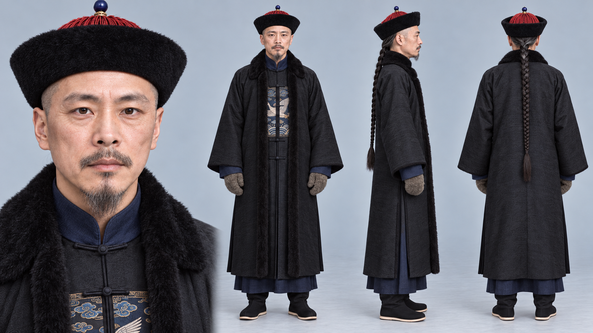
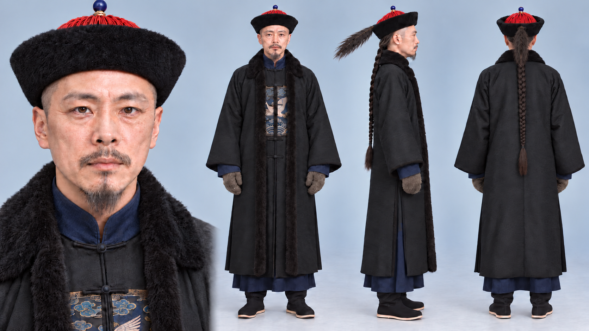

# 影视人物、服装与道具设计

从影视剧本拆出人物、服装和关键道具，结合原创设计、照片或史料参考，制作可复用的中文生图提示词与视觉参考图。

这是独立的 Codex 技能项目，适用于古装、年代、现代及幻想题材。工作范围是人物与服化道设计，不包含视频分镜、运镜或对白设计。

## 可以做什么

- 读取剧本，按指定集数或场次拆分人物、服装和道具清单。
- 根据照片或史料保留人物五官，设计不同年龄、季节与身份的造型。
- 制作同一人物的面部特写、正面全身、侧面全身和背面全身四视图。
- 设计服装的材质、配色、纹样、穿着层次及正侧背结构。
- 为重要道具设计独立细节图，为普通随身物件制作总览。
- 输出可独立使用的中文生图提示词，或调用可用的图像工具生成参考图。

## 带图制作过程

以下图片来自《金圣千秋》的人物资产制作过程，展示同一角色在定稿、换装和细节调整中的实际结果。它们是多轮制作的阶段选图，并非一次提示词就能完成的全部效果；中间还使用了已定稿的壮年形象和服装参考。

### 第一步：确定人物五官和基础造型

先明确角色年龄、身份、时代和参考用途，再制作面部特写与正、侧、背全身图。这个案例的青年李金镛设定为25岁药铺掌柜，定稿时调整了肩宽、肤质和帽位，作为后续年龄变化的身份依据。



示例要求：

```text
人物五官沿用已确认的李金镛形象，25岁，身形偏瘦、肩膀不宽。
穿晚清掌柜衣装，戴瓜皮帽，帽沿上提，露出额头。
面部特写独立放大，全身正侧背保持同一身体结构和自然站姿。
```

### 第二步：延续身份，生成年龄与季节变化

把已定稿人物图提供给图像工具，服饰参考另行指定用途。本轮生成50岁冬季形象：保留人物骨相，增加皱纹与灰白胡须，加入冬季暖帽、厚官服、御寒外褂和手套。



示例要求：

```text
人物五官按此前定稿参考，服装参考冬季剧照。
自然老化至50岁，增加适量眼角纹、法令纹及灰白胡须。
制作同一人物的面部特写、正面全身、侧面全身、背面全身。
```

### 第三步：根据反馈逐项调整配件

检查四视图后，针对官帽翎羽补充修改：先加上帽后翎羽，再校正为正后方朝向，随后反复微调俯仰角。下图是这些调整后的版本。侧面用于看清伸出角度，背面用于检查连接位置与中线关系，正面检查是否出现不合理的侧向外露。



示例修改要求：

```text
翎羽从帽后正中央朝人物正后方伸出，与辫子处在同一中线平面。
角度略向下，末端自然轻垂，避免向左右斜出。
本轮只微调翎羽角度，沿用已确认的面貌、冬装和四视图布局。
```

图像生成后仍需逐项检查面貌、体型、衣服结构和配件在不同视角中的对应关系。这些图用于美术与后续生成参考，不作为服制、官阶或历史考据的证明。

## 安装

把下面这段话发给 Codex：

```text
请使用 $skill-installer 安装这个 GitHub 仓库中的技能：
https://github.com/flemin86/film-character-costume-prop-design
```

也可以下载完整仓库，将包含 `SKILL.md`、`agents` 和 `references` 的目录放入个人技能目录，并命名为 `film-character-costume-prop-design`。安装后如未识别，重启 Codex 再调用。

## 使用示例

### 按剧本制作

```text
使用 $film-character-costume-prop-design。
第一个附件是完整剧本，第二个附件是第一集分镜。
只按第一集范围拆分主要人物、服装和关键道具。
采用写实影视风格，先确认清单，再输出中文提示词并生成参考图。
```

### 根据参考图换装

```text
使用 $film-character-costume-prop-design。
人物五官沿用已定稿图片，服装参考新附的剧照。
制作50岁冬季形象，输出面部特写和正、侧、背全身四视图。
```

### 单独设计道具

```text
使用 $film-character-costume-prop-design。
为剧中的药铺掌柜设计账本与算盘。
账本单独展示封面、打开状态和装订细节，输出中文提示词及参考图。
```

提供剧本范围、参考图用途和视觉风格即可。已在对话中确认的角色、风格与制作范围会继续沿用；单项设计可直接制作。

## 默认交付与一致性

人物默认采用16:9纯色背景四视图；服装采用正、侧、背穿着三视图，完整展示鞋履。普通道具可组成总览，重要道具单独细化。

换装与年龄变化保留人物身份。正侧背共用同一身体结构和缩放尺度，检查头身关系、自然站姿、服装结构、配件连接以及不同视角的一致性。普通写实成人缺少可靠全身参考时，以约7头身为设计起点；用户指定体态与可靠参考优先。

直接生成图片需要运行环境提供图像生成工具。生成结果仍需检查人物一致性、服装结构和道具细节；图片中的细小文字与纹章可能需要后期修正。技能不会把推定补全当作史料事实。

## 项目文件

```text
film-character-costume-prop-design/
├── SKILL.md
├── agents/
│   └── openai.yaml
├── references/
│   └── design-guide.md
├── assets/
│   └── process/（README 制作过程展示图）
├── README.md
└── LICENSE
```

请保留完整技能目录，`SKILL.md` 会按需引用设计指南。`assets/process/` 是 README 使用的生成过程展示图，运行技能无需加载这些图片。本项目不附完整剧本或原始剧照参考。

## 使用条款

沿用维护者的限制使用条款：允许个人非商业学习和使用，未经许可不授权修改、转载或商用。完整条件见 [LICENSE](LICENSE)。
